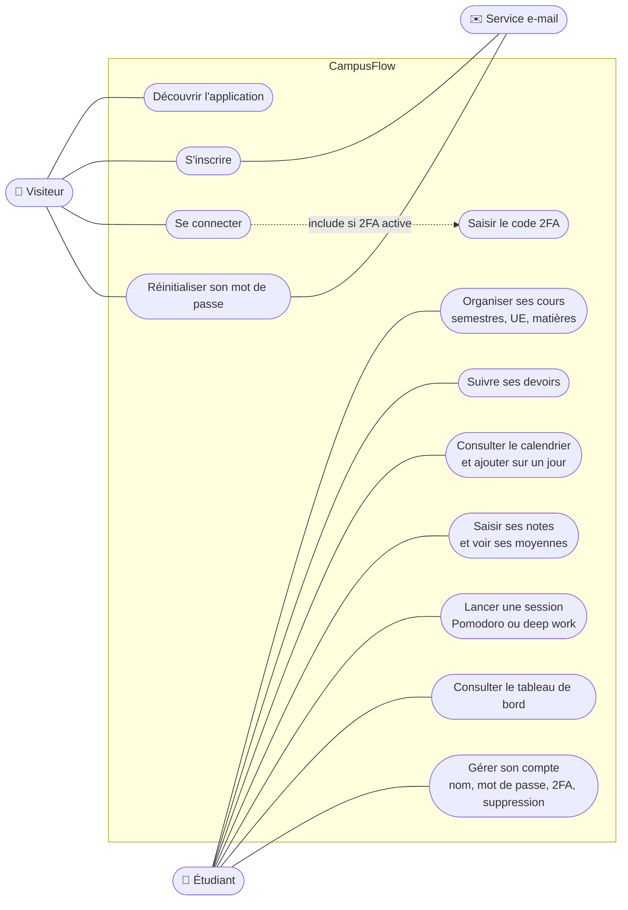

# Cas d'utilisation

Ce que chaque acteur peut faire dans CampusFlow. Les identifiants `EF-xx` renvoient aux
exigences du [cahier des charges](cahier-des-charges.md).

Mermaid n'a pas de diagramme de cas d'utilisation UML dédié : le schéma ci-dessous en reprend
les conventions (acteurs à gauche, cas d'utilisation dans le cadre du système).

Un visiteur devient étudiant en se connectant.

## Détail des cas principaux

### S'inscrire (EF-01, EF-02)

- **Acteur** : visiteur.
- **Scénario nominal** :
  1. Le visiteur saisit son prénom, son e-mail et un mot de passe.
  2. CampusFlow vérifie le formulaire, puis demande à Supabase de créer le compte.
  3. Supabase envoie un e-mail de confirmation.
  4. Le visiteur clique sur le lien : son compte est activé et il arrive sur le tableau de bord.
- **Variantes** :
  - Formulaire invalide : le message s'affiche sous le champ concerné.
  - Adresse déjà inscrite : le même message de succès est affiché, pour ne pas révéler quelles
    adresses ont un compte.

### Saisir une note (EF-30 à EF-35)

- **Acteur** : étudiant.
- **Préconditions** : un semestre, une UE et une matière existent.
- **Scénario nominal** :
  1. L'étudiant ouvre la page Notes et choisit la matière.
  2. Il saisit l'intitulé, la note, le barème et le poids.
  3. La note est enregistrée ; les moyennes de la matière, de l'UE et du semestre sont
     recalculées.
- **Variantes** :
  - Note supérieure au barème : refusée par le formulaire, puis par la base.
  - Matière supprimée entre-temps : message « Cette matière n'existe plus ».

### Ajouter une échéance depuis le calendrier (EF-23)

- **Acteur** : étudiant.
- **Préconditions** : au moins une matière existe.
- **Scénario nominal** :
  1. L'étudiant ouvre Devoirs, puis Calendrier : le mois en cours s'affiche, avec un point de la
     couleur de la matière sous chaque jour qui a une échéance.
  2. Il touche un jour : la liste des échéances de ce jour s'affiche sous la grille.
  3. Il touche « Ajouter pour le … » : le formulaire s'ouvre avec ce jour à 23:59.
  4. Il remplit le titre et la matière : l'échéance apparaît sur le jour choisi.
- **Variantes** :
  - Vue semaine : les 7 jours sont listés, chacun avec un bouton « + ».
  - Aucune matière : le calendrier invite à en créer une d'abord.

### Se connecter avec la double authentification (EF-03, EF-05)

- **Acteur** : visiteur ayant activé la 2FA.
- **Scénario nominal** :
  1. Il saisit son e-mail et son mot de passe.
  2. CampusFlow l'envoie sur la page de vérification.
  3. Il saisit le code à 6 chiffres de son application d'authentification.
  4. Il arrive sur la page demandée au départ.
- **Variante** : tant que le code n'est pas saisi, toutes les pages privées le renvoient vers la
  vérification, et la base refuse toute lecture.

Le déroulé technique de ces cas est dans [Séquences](sequences.md).
