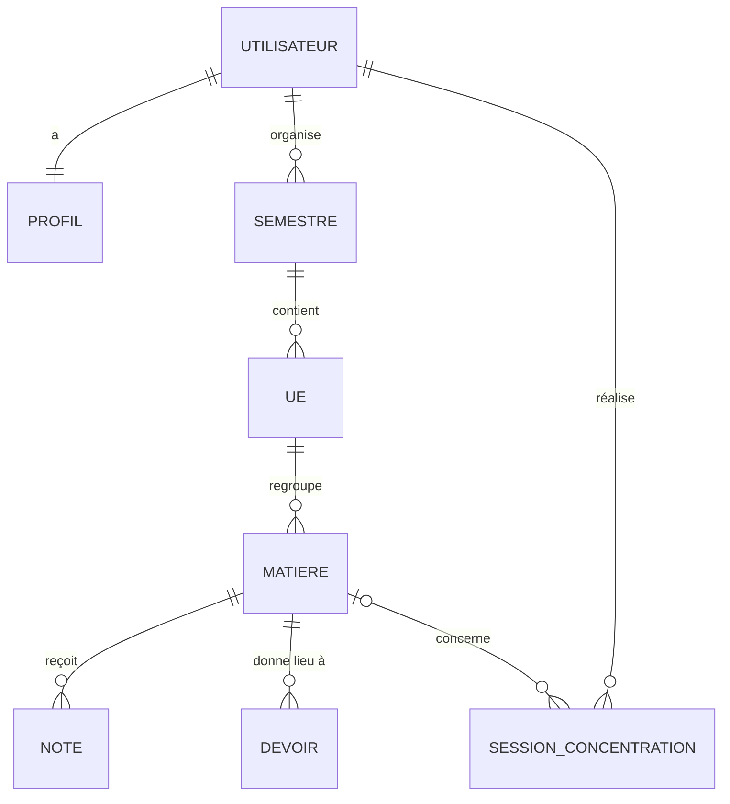
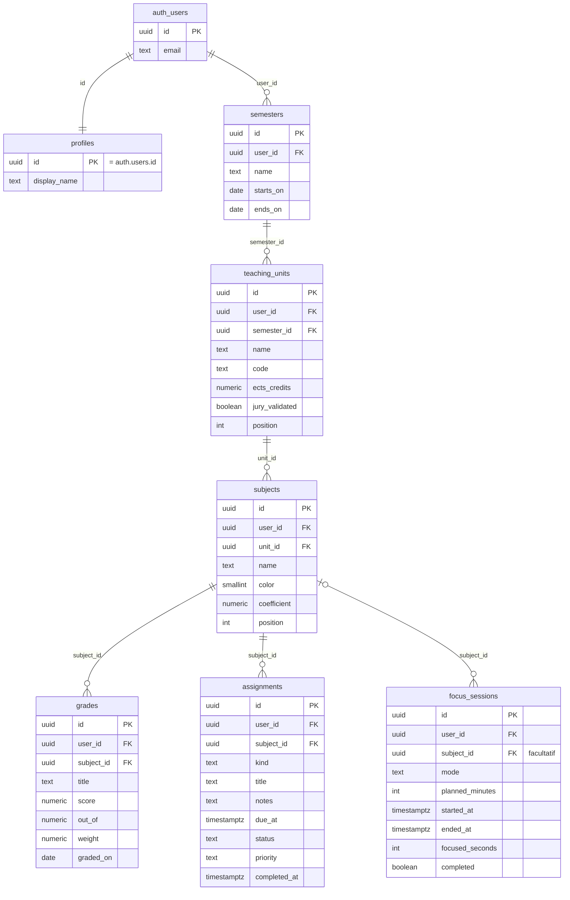

# Modèle de données

Ce document décrit la base de données de CampusFlow (PostgreSQL, hébergée par Supabase).
La source de vérité reste le dossier [`supabase/migrations/`](../supabase/migrations) : toute
modification d'une table se fait par une nouvelle migration, et ce document est mis à jour dans
la même pull request.

## Vue d'ensemble

Un étudiant organise son année en **semestres**. Un semestre contient des **unités
d'enseignement (UE)**, qui portent les crédits ECTS. Une UE regroupe des **matières**, qui portent
un coefficient. Tout le reste (notes, devoirs, sessions de concentration) est rattaché à une
matière.

```
Étudiant ─┬─ Semestre ── UE ── Matière ─┬─ Notes
          │                             ├─ Devoirs
          │                             └─ Sessions de concentration
          └─ Profil
```

## Modèle conceptuel (MCD)

Le schéma ci-dessous se lit avec les **cardinalités** : `||` = exactement un, `o|` = zéro ou un,
`o{` = zéro ou plusieurs. Par exemple « un semestre contient zéro ou plusieurs UE, une UE
appartient à exactement un semestre ».



Une session de concentration peut ne concerner aucune matière (`|o`) : on peut lancer un
Pomodoro sans choisir de matière, et une session survit à la suppression de sa matière.

## Modèle physique

Les tables réelles, avec leurs colonnes principales. `PK` = clé primaire, `FK` = clé étrangère.
Les colonnes `created_at` et `updated_at` (dates de création et de modification) existent sur
presque toutes les tables et ne sont pas répétées ici.



## Modèle logique (MLD)

Notation : la clé primaire est en **gras**, les clés étrangères sont précédées de `#`.

- **profiles** (**id**#, display_name)
- **semesters** (**id**, #user_id, name, starts_on, ends_on)
- **teaching_units** (**id**, #user_id, #semester_id, name, code, ects_credits, jury_validated,
  position)
- **subjects** (**id**, #user_id, #unit_id, name, color, coefficient, position)
- **grades** (**id**, #user_id, #subject_id, title, score, out_of, weight, graded_on)
- **assignments** (**id**, #user_id, #subject_id, kind, title, notes, due_at, status, priority,
  completed_at)
- **focus_sessions** (**id**, #user_id, #subject_id, mode, planned_minutes, started_at, ended_at,
  focused_seconds, completed)

## Règles portées par la base

La base ne se contente pas de stocker : elle refuse elle-même les données incohérentes, même si
une requête contourne l'application.

### Contraintes de valeurs (`check`)

| Table            | Règle                                                                          |
| ---------------- | ------------------------------------------------------------------------------ |
| `semesters`      | Nom de 1 à 60 caractères ; la date de fin est après la date de début.          |
| `teaching_units` | Crédits ECTS entre 0 (exclu) et 60.                                            |
| `subjects`       | Couleur de 1 à 8 ; coefficient entre 0 (exclu) et 100.                         |
| `grades`         | Note ≥ 0 et ≤ barème ; barème entre 0 (exclu) et 1000 ; poids entre 0 et 100.  |
| `assignments`    | Type `homework`, `project` ou `exam` ; statut `todo`, `in_progress` ou `done`. |
| `focus_sessions` | Mode `pomodoro` ou `deep_work` ; durée prévue de 1 à 480 minutes.              |

### Clés étrangères composites `(id, user_id)`

Chaque lien entre deux tables porte **aussi** le propriétaire. Par exemple, une UE pointe vers
`semesters (id, user_id)` et non vers `semesters (id)` seul. Conséquence : il est impossible de
rattacher une UE au semestre d'un autre étudiant, même en connaissant son identifiant.

### Suppressions en cascade

- Supprimer un semestre supprime ses UE, puis leurs matières, puis leurs notes et devoirs.
- Supprimer une matière **conserve** ses sessions de concentration (le lien est simplement vidé),
  pour que le temps de travail total reste juste.
- Supprimer le compte (`public.delete_my_account()`) supprime toutes les données de l'étudiant.

### Automatismes (`trigger`)

- À l'inscription, un profil est créé automatiquement (`handle_new_user`).
- `updated_at` est mis à jour à chaque modification (`set_updated_at`).
- Un devoir passé à « terminé » reçoit sa date de fin (`set_assignment_completed_at`).

## Sécurité

- **RLS activée sur toutes les tables** : chaque politique vérifie `auth.uid() = user_id`. Un
  étudiant ne peut lire, créer, modifier ou supprimer que ses propres lignes.
- **Double authentification** : des politiques _restrictives_ s'ajoutent aux précédentes. Pour
  un compte qui a activé la 2FA, une session ouverte avec le seul mot de passe n'a accès à rien
  tant que le code n'a pas été saisi (`private.mfa_satisfied()`).
- Les sessions de concentration ne peuvent pas être modifiées après coup : il n'existe pas de
  politique `update` sur `focus_sessions`.

## Historique des migrations

| Migration                                        | Contenu                                     |
| ------------------------------------------------ | ------------------------------------------- |
| `20261110170000_create_profiles`                 | Profils, création automatique.              |
| `20261111090000_create_semesters_units_subjects` | Semestres, UE, matières.                    |
| `20261111140000_create_assignments`              | Devoirs, projets, examens.                  |
| `20261111180000_create_grades`                   | Notes, validation par le jury.              |
| `20261112090000_create_focus_sessions`           | Sessions Pomodoro et deep work.             |
| `20261113090000_enforce_mfa`                     | Double authentification exigée par la base. |
| `20261114090000_delete_own_account`              | Suppression de son propre compte.           |
