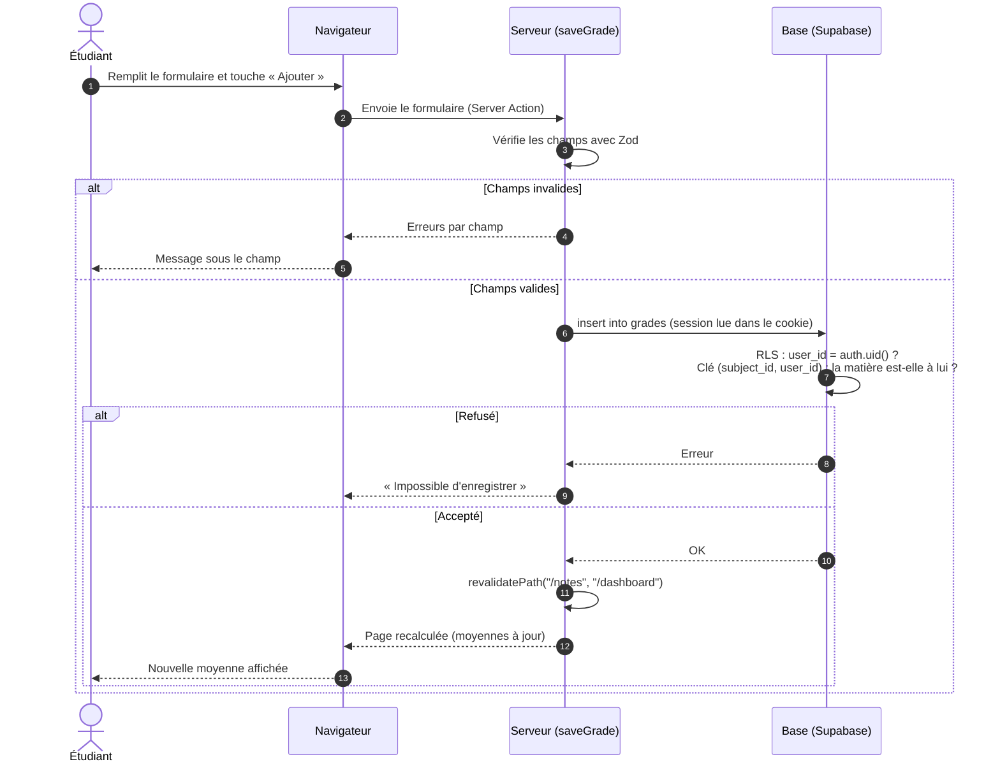
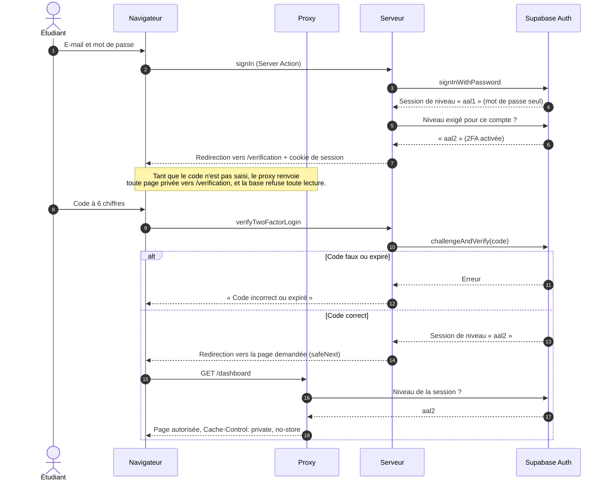
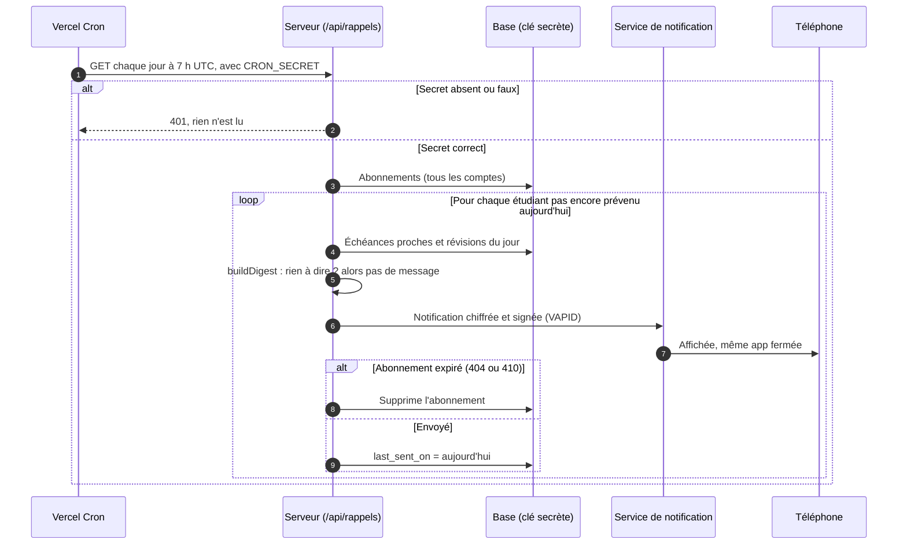
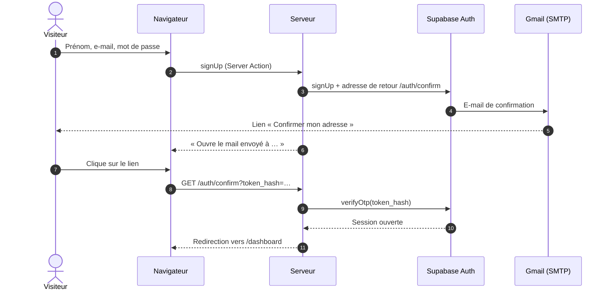

# Diagrammes de séquence

Qui parle à qui, et dans quel ordre, pour les parcours les plus importants. Les participants :

- **Navigateur** : le téléphone ou l'ordinateur de l'étudiant.
- **Proxy** : `src/proxy.ts`, exécuté avant chaque page.
- **Serveur** : les pages et les Server Actions de Next.js, hébergées sur Vercel.
- **Supabase Auth** et **Base** : les comptes et la base PostgreSQL.

## Ajouter une note

Fichiers : `src/features/grades/components/grade-form.tsx`, `src/features/grades/actions.ts`,
`src/features/grades/lib/average.ts`.

## Se connecter avec la double authentification

Fichiers : `src/features/auth/actions.ts`, `src/features/two-factor/actions.ts`,
`src/lib/supabase/proxy.ts`, `supabase/migrations/20261113090000_enforce_mfa.sql`.

## Rappel du matin

Fichiers : `vercel.json`, `src/app/api/rappels/route.ts`, `src/features/reminders/`,
`public/sw.js` (affichage et ouverture de la notification).

## Confirmer son inscription

Fichiers : `src/features/auth/actions.ts`, `src/app/auth/confirm/route.ts`,
`supabase/templates/confirm-signup.html`.
